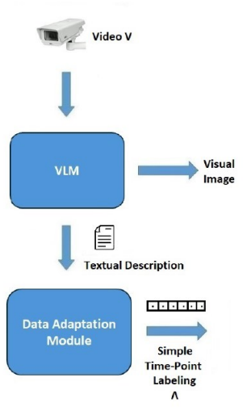
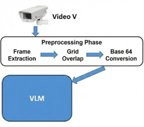
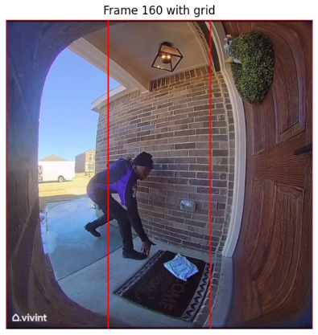

# VLM-ISEQL Task Report

## 1. Task Specification
> In the context of the video surveillance architecture combining VLM >and ISEQL, please
implement and test the first two levels of the pipeline on video in different contexts
(including homemade). As regards VLMs, you could use qwen 2.5 or other versions on ollama,
gemini 1.5 robotics view on Google AI studio via API Key, or any other tool deemed
appropriate

## 2 Pipeline Description
As the task requires the implementation of the first two levels of the pipeline, we reported them in the following image, taken from the course slides.

>

## 3. Implemented Pipeline
In this section we'll be going through the entire first two-level pipeline implementation, from the video taken in input by the VLM to the Simple Time-Point Label provided to the third level of the entire pipeline.

Obviously, since we are pretty limited from the VLM side, pretty much due to tokens, we'll test this pipeline on simple video and scenarios, like couriers dropping off packages.

### 3.1 From Video to VLM: Reaching the First Level of the Pipeline
Video recorded by video camera cannot be provided directly to the VLM, there must be a **preprocessing phase**.

First of all frames must be **extracted** from the video and then a grid must be **overlapped**. To provide the VLM with a valid input, we also **convert** frames in **base 64**.

> 

#### 3.1.1 Frame Extraction
Since we're considering simple video and scenarios and don't want to overload the VLM, for the "dropping off packages" topic, extracting 1.5 FPS (1 frame per 0.66 seconds) from a video is sufficient. It's the best trade-off that we could make between VLM image-reasoning completion time and information amount provided per frame.

#### 3.1.2 Grid Overlapping
Referring to the original pipeline, the overlapped grid frame (the so called **Visual Image**) is generated in this phase, before going to the VLM. This is possible through a simple Python script that applies the grid to the frame, without relying too much on the VLM, that is limited to image-reasoning purposes.

Each frame has been structured into a 1x3 matrix, so 1 row and 3 columns, in this case we will refer to them as **3 cells**. This structure will also be used by the VLM to provide descriptions of what happens in each cell of the frame.



#### 3.1.3 Base 64 Conversion
The final step of this first phase in the **base 64 conversion** of each frame, that is the input for the next layer, the VLM.


### 3.2 From VLM to Data Adaptation Module: From the First to the Second Level of the Pipeline
The first level of the pipeline **analyses frames** in base 64, elaborated in the previous preprocessing phase.
Now **Frame-Reasoning** is performed by the VLM to provide the next level a coherent input.

#### 3.2.1 VLM: Frame-Reasoning
The **base 64** string is analysed by the VLM and produces a **textual description** already **serialized**, it is a JSON-string for each cell of the frame, that has the following structure.

> **Referring to the i-th cell of the frame**
>
>```json
>  "cell_i": {
>    "reasoning": "",
>    "people": "",
>    "objects": "",
>    "action": ""
>  }
>```

Since a video is composed by multiple frames, this cells will be packed into a JSON-array string

### 3.3 From Data Adaptation Module: To the Third Level of the Pipeline