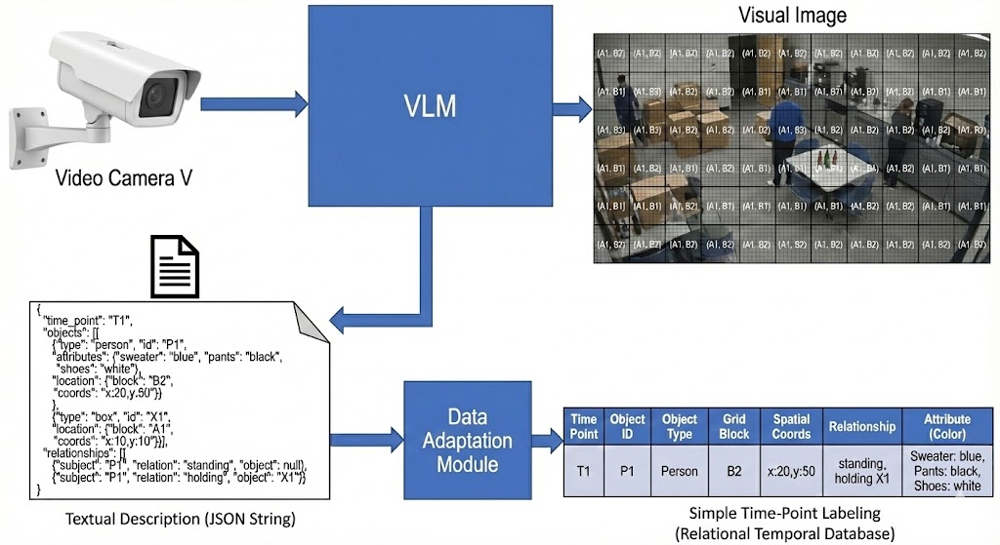

# VLM-ISEQL Task Report

## 1. Task Specification
> In the context of the video surveillance architecture combining VLM >and ISEQL, please
implement and test the first two levels of the pipeline on video in different contexts
(including homemade). As regards VLMs, you could use qwen 2.5 or other versions on ollama,
gemini 1.5 robotics view on Google AI studio via API Key, or any other tool deemed
appropriate

## 2 Pipeline Description
As the task requires the implementation of the first two levels of the pipeline, we reported them in the following image, taken from the course slides:

> **The Pipeline**
>
>

More in details, this pipeline can be expanded a little bit, starting from the VLM output, that can be specialized in a JSON string, that is then deserialized by the Data Adaptation Module that converts it into a feasible input (such as a `.csv` file, list of dictionaries in Python, etc...) for the next level of the pipeline. So, this can then be integrated in a full pipeline including the missing levels.

> **Extended Pipeline Example**
>
> This is just an example of the "extended pipeline" to clarify steps generated with Nano Banana Pro, don't take it as a representation of the final implementation
>
>

